# FedProC: A Benchmarking Framework for Federated Time-Series Forecasting

**Federated Prognos Chronos** – A federated learning framework for time-series forecasting.

📖 **Documentation**: [https://fedproc.readthedocs.io/](https://fedproc.readthedocs.io/)

📦 **Version**: [](https://github.com/nclabteam/FedProC/releases/latest)

---

## Overview

FedProC is a comprehensive federated learning framework designed specifically for time-series forecasting tasks. It enables distributed machine learning across multiple clients while preserving data privacy.

## Experiment Workflow

```mermaid
flowchart LR
    dataset["Choose a dataset"] --> model["Choose a forecasting model"]
    model --> strategy["Choose a federated strategy"]
    strategy --> run["Run an experiment"]
    run --> compare["Compare results"]
    click dataset href "https://github.com/nclabteam/FedProC/blob/main/docs/datasets.md" "Dataset guide" _blank
    click model href "https://github.com/nclabteam/FedProC/blob/main/docs/models.md" "Model guide" _blank
    click strategy href "https://github.com/nclabteam/FedProC/blob/main/docs/strategies.md" "Strategy guide" _blank
    click run href "https://github.com/nclabteam/FedProC/blob/main/docs/usage.md" "Usage guide" _blank
    click compare href "https://github.com/nclabteam/FedProC/blob/main/docs/analysis.md" "Analysis guide" _blank
```



Configure the forecast window, client participation, and local training for your experiment. FedProC trains the clients, applies the selected strategy, and saves metrics for analysis.

## 📚 Awesome Federated Learning & Time Series Forecasting

A curated collection of research papers on **federated learning** and **time series forecasting** — searchable, filterable, and updated regularly.

👉 **[fedproc-lemon.vercel.app](https://fedproc-lemon.vercel.app)** — browse 8000+ papers by venue, year, and topic

## Star History

<a href="https://www.star-history.com/#nclabteam/FedProC&Timeline">
 <picture>
   <source media="(prefers-color-scheme: dark)" srcset="https://api.star-history.com/svg?repos=nclabteam/FedProC&type=Timeline&theme=dark" />
   <source media="(prefers-color-scheme: light)" srcset="https://api.star-history.com/svg?repos=nclabteam/FedProC&type=Timeline" />
   
 </picture>
</a>

## Features

- 🔒 **Privacy-Preserving**: Keeps data local while enabling collaborative learning
- 📈 **Time-Series Focused**: Optimized for forecasting tasks
- 🚀 **Scalable**: Supports multiple clients and strategies
- 🧩 **Modular**: Easy to extend with custom models and strategies

## Quick Start

Get started with FedProC in just a few steps:

1. [Installation](docs/installation.md) - Set up your environment
2. [Usage](docs/usage.md) - Run your first experiment
3. [Strategies](docs/strategies.md) - Choose your federated learning strategy (80 strategies)

## Documentation Structure

- **[Installation](docs/installation.md)** - Installation guide and requirements
- **[Usage](docs/usage.md)** - Basic usage and examples
- **[Strategies](docs/strategies.md)** - Available federated learning strategies (80 strategies)
- **[Attacks](docs/attacks.md)** - Attack registry for adversarial evaluation (6 attacks)
- **[Datasets](docs/datasets.md)** - Supported datasets and data preparation (73 datasets)
- **[Models](docs/models.md)** - Available models and architectures (82 models)
- **[Augmentations](docs/augs.md)** - Custom GPU-native PyTorch augmentations (8 augmentations)
- **[Losses](docs/losses.md)** - Loss functions and metrics (19 losses)
- **[Optimizers](docs/optimizers.md)** - Optimization methods (9 optimizers)
- **[Schedulers](docs/schedulers.md)** - Learning rate schedulers (8 schedulers)
- **[Scalers](docs/scalers.md)** - Data scaling methods (5 scalers)
- **[Customization](docs/customization.md)** - Extending the framework
- **[Code Formatting](docs/formatting.md)** - Development guidelines
- **[Analysis](docs/analysis.md)** - Results analysis

## Contributing

We welcome contributions! Please see our contributing guidelines for more information.

## License

This project is licensed under the MIT License - see the LICENSE file for details.

## Citation

<details open>
<summary>FedProC (SoftwareX 2026)</summary>

[](https://doi.org/10.1016/j.softx.2026.102646)
[](https://github.com/nclabteam/FedProC)

If you use this work, please cite:

```bibtex
@article{NGUYEN2026102646,
    title = {FedProC: A Benchmarking Framework for Federated Time-Series Forecasting},
    journal = {SoftwareX},
    volume = {34},
    pages = {102646},
    year = {2026},
    issn = {2352-7110},
    doi = {https://doi.org/10.1016/j.softx.2026.102646},
    author = {Khoa Nguyen and Taehong Kim},
}
```

</details>

<details>
<summary>FedA2L (Future Generation Computer Systems 2027)</summary>

[](https://doi.org/10.1016/j.future.2026.108743)
[](https://arxiv.org/abs/2608.09208)
[](https://github.com/nclabteam/FedA2L)

```bibtex
@article{VO2027108743,
    title = {FedA2L: Adaptive layer-wise learning rate adjustment in decentralized federated learning},
    journal = {Future Generation Computer Systems},
    volume = {186},
    pages = {108743},
    year = {2027},
    issn = {0167-739X},
    doi = {https://doi.org/10.1016/j.future.2026.108743},
    url = {https://www.sciencedirect.com/science/article/pii/S0167739X26003778},
    author = {Van Truong Vo and Khoa Nguyen and Taehong Kim},
}
```

</details>
